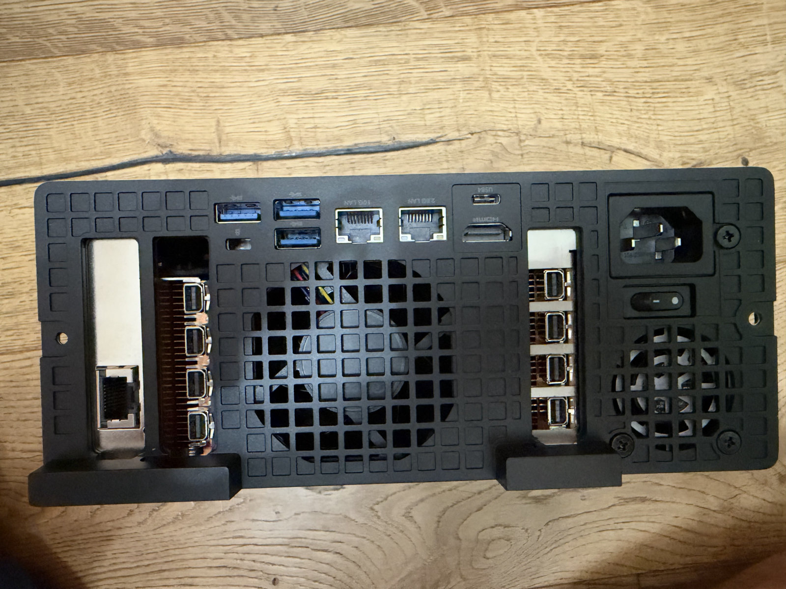
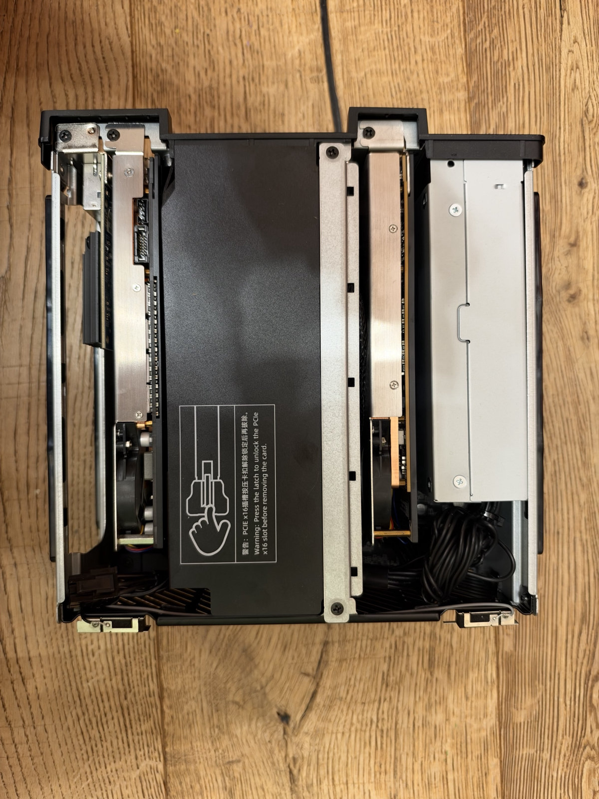
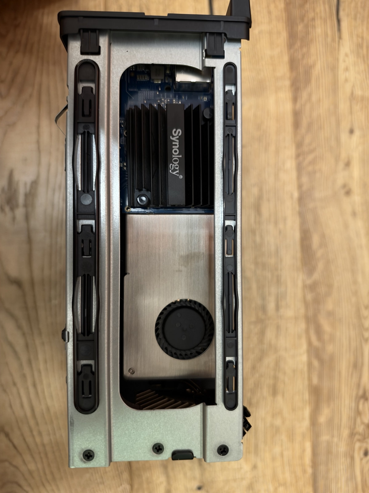
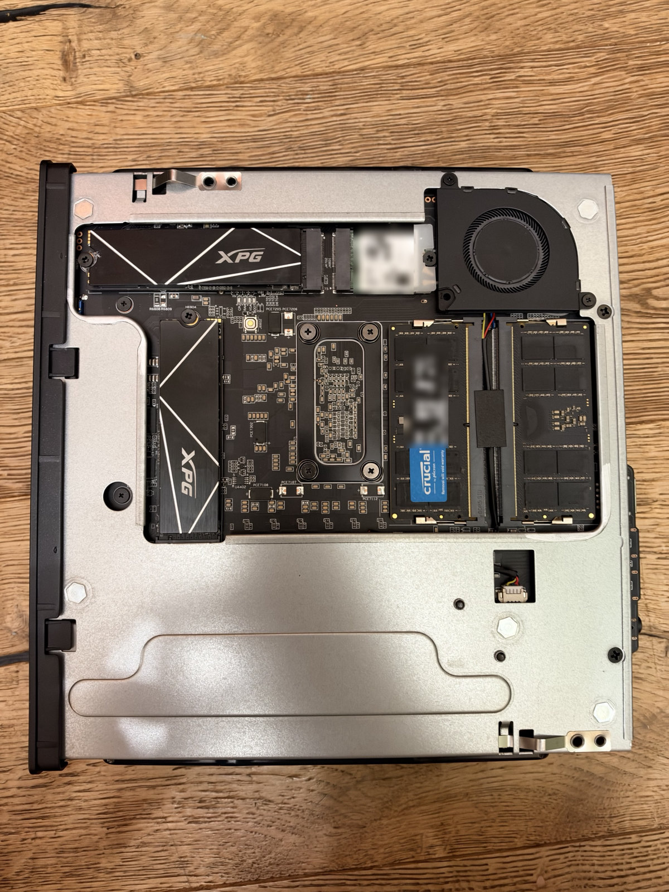
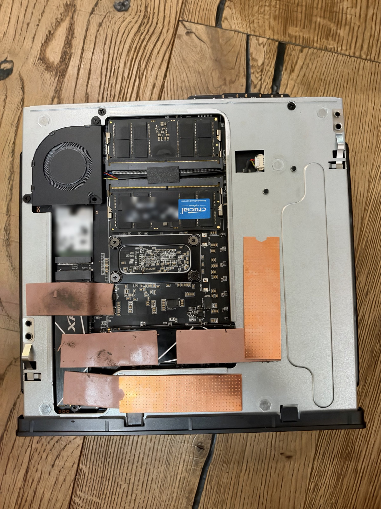

# Minisforum MS-02 Ultra with two Blackwell workstation GPUs on the stock PSU

**RTX PRO 4000 Blackwell SFF 24 GB + RTX PRO 2000 Blackwell 16 GB in one MS-02 Ultra (Core Ultra 9 285HX, 192 GB),
running Proxmox with local LLMs in LXC containers.** Build notes, the settings that mattered, a 2-hour load test and
LLM numbers for each card.

- Both cards wear single-slot coolers and run at their 70 W limit, so they need no 8-pin cable. The 2000 sits in the
  **top bay**, where Minisforum's 2×25G card normally goes.
- It replaced two MS-01s, each with one of these GPUs, plus some containers that ran on my NAS.
- A 2-hour load test with every guest running finished with **zero request errors**: CPU, both GPUs doing real LLM
  inference, and both SSDs, all at once for 25 minutes. The only GPU limiter reported was the power cap.
- **The top-bay card runs hot**: 90–91 °C on average under load, 94 °C peak.
- For these models and settings, **one model per card worked well**. Splitting one model across both cards with the
  Strata engine I use cut prefill to roughly 40–60 % of a single card, and the engine crashed under parallel requests.

One unit, one owner, BIOS 1.04, in this configuration since 10 October 2026. No wall-power or noise measurements.

*Rear view. Left: the 10GbE card and the RTX PRO 4000. Right, next to the power inlet: the RTX PRO 2000 in the top
bay. More [photos](#photos) below.*

## Why

I had two MS-01s, each with one of these GPUs. The MS-02 Ultra has a CPU-connected Gen5 x16 slot. Its top bay takes
an ordinary card at Gen4 x4 once Minisforum's 25G card is out. So I tried putting both GPUs into one box.

I am not the first to put two GPUs in an MS-02:
[this build](https://www.reddit.com/r/MINISFORUM/comments/1sv0a8w/ms02_ultra_dual_gpu_setup/) (April 2026) used an
RTX 5060 LP plus an RTX 4000 SFF Ada converted to a single-slot cooler, with a 600 W PSU swap. Mine is the 70 W Blackwell pair on the stock PSU.
Someone asked about exactly this combination
[here](https://www.reddit.com/r/MINISFORUM/comments/1so0c6v/running_dual_gpus_on_the_ms02_ultra/).

## Hardware

| Part | What | Notes |
|---|---|---|
| Box | Minisforum MS-02 Ultra, Core Ultra 9 285HX barebone | BIOS 1.04, the latest available when I set it up |
| RAM | 4 × 48 GB DDR5 SO-DIMM, non-ECC = 192 GB | runs at 4400 MT/s with two modules per channel |
| GPU 1 | NVIDIA RTX PRO 4000 Blackwell SFF, 24 GB | lower CPU-connected slot (Gen5 x16 physical); observed **Gen5 x8** under load |
| GPU 2 | NVIDIA RTX PRO 2000 Blackwell, 16 GB | **top bay**; observed **Gen4 x4** under load |
| GPU coolers | [n3rdware](https://n3rdware.com) single-slot coolers for both cards (EUR 89 each, June 2026, fitted earlier for my MS-01s) | the stock coolers are dual-slot |
| Lower x4 slot | 10GbE RJ45 card with an x4 edge | the slot is closed-ended x4 with components right behind it, so longer x8/x16-edge cards do not fit directly |
| Storage | 2 × 8 TB NVMe on the board | one in the CPU-connected slot, one in the chipset slot |
| PSU | stock internal unit | both GPUs on slot power only, no 8-pin |
| SSD cooling | 2 × Thermal Grizzly Minus Pad 8 (120 × 20 × 1 mm) + two cheap copper heatsinks | a prototype, see [SSD throttling](#ssd-throttling) |

**Fit.** The top bay only has room for a single-slot card (I estimated a gap of about 28 mm), so the PRO 2000 needs
the thin cooler there. In the lower bay a dual-slot card would also cover the adjacent x4 slot, which I use for the
NIC. I did not try two stock-cooled cards.

**Power.** Both cards have a 70 W limit. ServeTheHome's review lists a 350 W PSU, and Minisforum's guide specifies 75 W
per PCIe slot. This configuration completed the load test below on the stock PSU. I did not measure whole-system
consumption or the remaining PSU margin.

**The 25G card.** My barebone came with the 2×25GbE (Intel E810) card in the top bay. It has its own blower; I took it
out for the GPU. I expect the change in overall power and heat to be small, but I did not measure it.

**CPU limits.** With a discrete GPU installed, the BIOS lowers the 285HX's default limits from 100/140 W to 90/110 W
(PL1/PL2), according to STH and Minisforum's guide. I run the Balanced profile with 90/110 W, TCC 90 °C and the fans
on Performance.

## Photos

<table>
<tr>
<td width="50%"></td>
<td width="50%"></td>
</tr>
<tr>
<td>Both bays from above, lid off. Left: the 10GbE card and the RTX PRO 4000 with its single-slot cooler; the black
cover in the middle is the x16 slot latch. Right: the RTX PRO 2000 in the top bay, next to the PSU.</td>
<td>Lower bay from the side: the Synology 10GbE card (E10G18-T1) with the RTX PRO 4000's single-slot blower cooler
next to it.</td>
</tr>
<tr>
<td></td>
<td></td>
</tr>
<tr>
<td>Underside, cover off, before the SSD cooling: the two NVMe drives with their stock heat spreaders.</td>
<td>The same side with the SSD cooling prototype: Thermal Grizzly Minus Pad 8 pieces (1 mm) on both drives and two
cheap copper heatsinks (see <a href="#ssd-throttling">SSD throttling</a>).</td>
</tr>
</table>

Labels on the RAM and the Wi-Fi card are blurred.

## Settings that mattered

- **BIOS:**
  - Internal Graphics = Enabled, Primary Display = IGFX. With the GPUs installed the iGPU was disabled until I set
    this. It keeps the iGPU for media transcoding next to the two NVIDIA cards.
  - VT-d on.
  - Secure Boot off after the initial boot violation. Setting up a signed boot chain and signed NVIDIA modules is
    still to do.
  - AMT/MEBx idle timeout = 65535. This is a known BIOS 1.04 issue; without it AMT stops answering after power-off.
  - The x16 slot's clock assignment and ClkReq were already at Platform-POR on my unit.
- **Proxmox host:** the NVIDIA open driver runs on the host, and the GPUs are kept out of D3cold (a known wake problem
  on this platform). Each GPU container gets its card's `/dev/nvidiaN` by matching the model name to the driver's
  device minor: [`scripts/gpu-pin.sh`](scripts/gpu-pin.sh). After moving cards, run it again and restart the containers.
- **AER log flood:** the Thunderbolt root port `80:1b.4` floods the log with PCIe AER messages, about 20,000 lines.
  [`scripts/aer-quiet-tbport.sh`](scripts/aer-quiet-tbport.sh) with its [unit](systemd/aer-quiet-tbport.service) masks
  error reporting on that one port at boot. That silences it; it does not fix the firmware.
- **Console:** `i915.enable_fbc=0` on the kernel command line fixed a garbled iGPU console.
- **CPU governor:** `intel_pstate` with the `powersave` governor and EPP `balance_performance`
  ([script](scripts/cpu-powersave-epp.sh), [unit](systemd/cpu-powersave-epp.service)). Turbo still comes on demand.

## Load test (2 hours, every guest running)

The load was real inference on both GPUs (an LLM server on each card), `stress-ng` on all 24 threads and `fio` on
both SSDs. Values are average / maximum.

| Phase | CPU | RTX PRO 4000 (Gen5 x8) | RTX PRO 2000 (Gen4 x4) | Requests |
|---|---|---|---|---|
| CPU only, 15 min | 3.80 GHz, 90 W (peak 110 W), 78.5 / 85 °C | idle | idle | |
| Both GPUs, 15 min | peak 91 °C | 70 W, 82 / 87 °C, 1,414 MHz, fan 60 / 69 % | 70 W, 90 / 94 °C, 2,093 MHz, fan 79 / 90 % | 109 on the 4000 and 129 on the 2000, 0 errors |
| Everything at once, 25 min | 99 % busy, 4.12 GHz, 90 W, 81 / 85 °C | 66 W, 83 / 87 °C, 1,655 MHz | 69 W, 91 / 94 °C, 2,207 MHz, fan up to 96 % | 150 and 199, 0 errors; SSD writes 657 MiB/s |

- Both links stayed at Gen5 x8 / Gen4 x4 in every sample of the GPU and combined phases.
- The sampled clock-event masks showed only power-cap limiting, or no active limiter at all. No thermal-slowdown flags
  appeared.
- **The top-bay card is the weak spot.** That bay gets no chassis airflow, which reviewers also note. The PRO 2000's
  fan ran near full speed. Its lowest reported margin to the driver's temperature limit was 2 °C in the GPU phase and
  1 °C in the combined phase. I did not measure room temperature, so I can't say how it behaves in a warmer room.
- The 10GbE card in the lower x4 slot peaked at 88 °C in the combined phase and 89 °C in the GPU-only phase.

### SSD throttling

This isn't GPU-related, but it's worth knowing:
- **Before the fix** (BIOS fans on Quiet and the CPU on Silent 55/65 W at the time), sustained writes to the two-drive
  stripe fell from about 2.3 GB/s to 360 MB/s and eventually 120 MB/s, while the drive in the CPU-side slot heavily
  throttled at 72–73 °C. Switching the BIOS to Performance fans and the Balanced CPU profile, before any cooling
  hardware change, still left that drive heavily throttling, with the stripe at about 0.5 GB/s after the burst.
- **The fix:** two Thermal Grizzly Minus Pad 8 strips (120 × 20 × 1 mm), cut into pieces on both drives, and two
  cheap copper heatsinks, plus swapping the drives between the slots ([photo](photos/underside-ssd-cooling.jpg)),
  with the fans on Performance. This is a **prototype**. I'm looking for a more permanent solution, but
  with these drives some cooling was clearly needed.
- **After:** a 20-minute retest averaged 2,486 MiB/s, about 2.1 GB/s sustained after the initial burst. The severe
  collapse was gone. The CPU-slot drive still sat at its ~72 °C throttle point with light throttling most of the
  time, and heavy throttling briefly returned during cooldown.

## Local LLMs on the two cards

**The layout I kept:** a large MoE model on the 24 GB card and a smaller "lookup" model on the 16 GB card, each in its
own LXC container. With both running flat out, the large model lost about 10 % of its decode speed at depth, and the
small one was unaffected.

**Large model:** Qwen3.8-Flash-Next in 2-bit (IQ2_XS) on the Strata engine 0.1.39. Strata keeps hot experts in VRAM
and streams the rest from system RAM; its container had 64 GB of the host's 192 GB. Rates are in tokens/s:

| Setup | Prefill 2k / 32k / 100k | Decode | Two simultaneous 16k requests |
|---|---|---|---|
| One GPU, parallel 1, default I/O | 1,159 / 1,690 / 1,553 | 64.6 | 32.5 s |
| One GPU, parallel 2, mmap | 1,030 / 1,525 / 1,469 | 60.1 | 35.4 s |
| Automatic split over both GPUs, parallel 1, mmap | 647 / 695 / 613 | 60.6 | 62.7 s |
| Automatic split, parallel 2 or 4, mmap | ~600 / ~640 / ~600 | 65–66 | crashed |

How it was measured:
- Prefill and decode use single requests. Decode is the median of three short-prompt runs, each asking for 512
  output tokens.
- The last column is the elapsed time for two simultaneous requests, each with a ~16k-token prompt and 256 output
  tokens.
- The automatic split put 6.3 GB on the smaller card. Expert-cache capacity grew from 13,038 to 14,029 experts
  (+7.6 %), while prefill fell to 56–63 % of a single card at 2k and about 40–46 % at 32k and 100k (the range covers the
  default-I/O and mmap single-card rows). These tests
  did not isolate the cause of the slowdown.

**Other models, one card each** (Ollama; decode tok/s, plus prefill where measured):

| Card | Model | Decode | Prefill |
|---|---|---|---|
| PRO 2000 16 GB | Qwen3 4B | 84 | ~4,100 |
| PRO 2000 16 GB | gpt-oss 20B | 56 | ~3,100 |
| PRO 2000 16 GB | Qwen3.6-35B-A3B IQ3_XXS, 160k context | 74 (63 at depth) | 1,337 → 954 at 100k |
| PRO 2000 16 GB | Qwen3.8-27B IQ3_XXS | 27 | 546 |
| PRO 4000 24 GB | Qwen3-Coder 30B-A3B | 109 (46 at depth) | — |
| PRO 4000 24 GB | Gemma 4 26B | 85 | 2,200–2,700 |
| PRO 4000 24 GB | Qwen3.6-35B-A3B IQ4_XS MTP, 128k context | 99 (100 at depth) | 1,698 → 992 at 100k |
| PRO 4000 24 GB | Qwen3.8-27B Q4_K_M, 120k context | 20 | 633 → 335 |

## Caveats

- One unit and BIOS 1.04. In this configuration since 10 October 2026; the final SSD cooling since 11 October.
- No wall-power, noise or room-temperature measurements.
- The SSD cooling is a prototype (thermal pads and cheap copper heatsinks), not a finished solution.
- Not tested: a card above 70 W in the top bay, the 8-pin cable, two 24 GB cards, or two stock-cooled cards.

## Files

| Path | What |
|---|---|
| [`scripts/gpu-pin.sh`](scripts/gpu-pin.sh) | assign each Proxmox LXC container its own NVIDIA card by model name (dry run by default) |
| [`scripts/aer-quiet-tbport.sh`](scripts/aer-quiet-tbport.sh) + [`systemd/aer-quiet-tbport.service`](systemd/aer-quiet-tbport.service) | mask the AER flood on the Thunderbolt root port at boot |
| [`scripts/cpu-powersave-epp.sh`](scripts/cpu-powersave-epp.sh) + [`systemd/cpu-powersave-epp.service`](systemd/cpu-powersave-epp.service) | `powersave` governor with EPP `balance_performance` |
| [`photos/`](photos/) | build photos (shown [above](#photos)) |

Install the scripts to `/usr/local/sbin/` and the units to `/etc/systemd/system/`, then `systemctl enable --now` the
units. Read each script first: they write to PCI configuration space or to the Proxmox container configuration.

## Links

- n3rdware single-slot coolers:
  [RTX PRO 4000 Blackwell SFF](https://n3rdware.com/gpu-coolers/single-slot-rtx-pro-4000-blackwell-sff-cooler),
  [RTX PRO 2000 Blackwell](https://n3rdware.com/gpu-coolers/single-slot-rtx-pro-2000-blackwell-cooler)
- [ServeTheHome: Minisforum MS-02 Ultra review](https://www.servethehome.com/minisforum-ms-02-ultra-review-intel-new-home-lab-king/)
- [Minisforum MS-02 Ultra guide](https://github.com/minisforum-docs/MS-02-Ultra/blob/main/Docs/English/02-Ultra-BaseGuide.md)
  and [known issues](https://github.com/minisforum-docs/MS-02-Ultra/blob/main/Docs/English/02-Ultra-KnowIssue.md)

*Disclosure: an AI assistant wrote the helper scripts and the load-test harness, ran the tests on my box at my
request, pulled the numbers from the logs and drafted this write-up. The hardware, the build and the decisions are
mine.*

## License

GPL-3.0 (see [LICENSE](LICENSE)).
